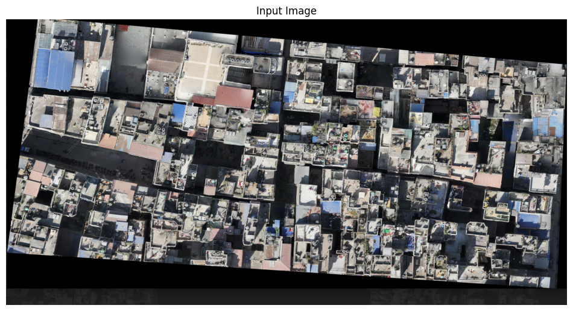
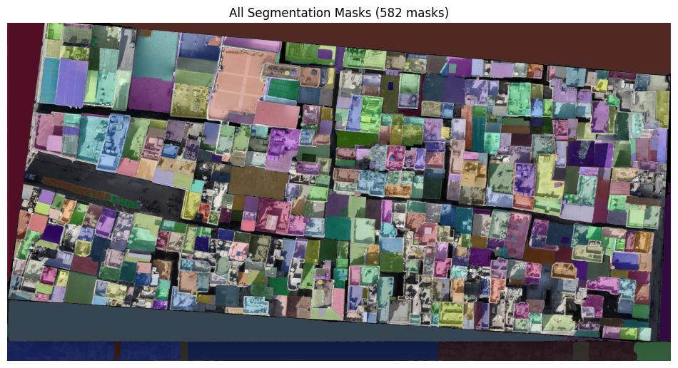
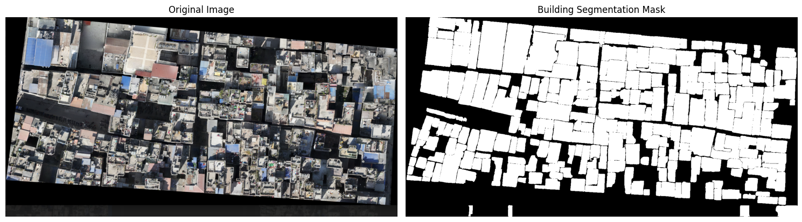

# Building Segmentation with the Segment Anything Model (SAM)

Segmenting rooftops in an aerial image with Meta's Segment Anything Model (ViT-H), run in Google Colab.

**Workflow:** load SAM → generate masks automatically → filter masks by area and shape → merge them into a binary building mask → convert to polygons → export as GeoJSON for QGIS.

**Result:** SAM generated 582 masks on an 818 × 1604 px image, and 510 of them were kept as likely buildings after filtering.

| Input | All SAM masks |
|---|---|
|  |  |

Notebook: [SAM_Building_Segmentation.ipynb](SAM_Building_Segmentation.ipynb)

Tools: PyTorch, segment-anything, OpenCV, GeoPandas, Rasterio, Shapely.
